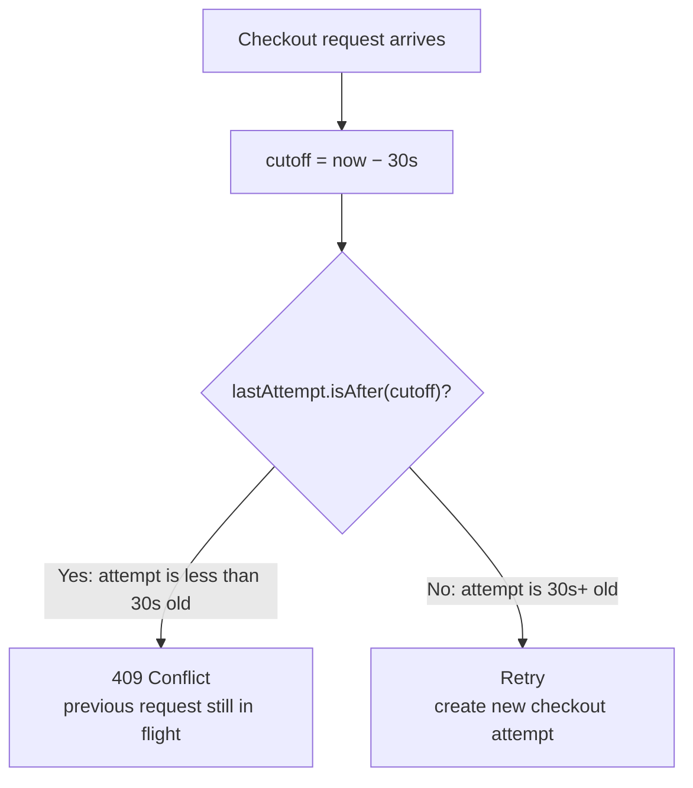
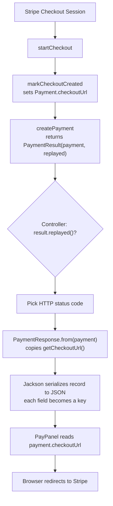
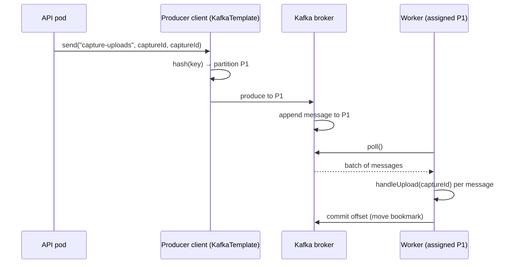
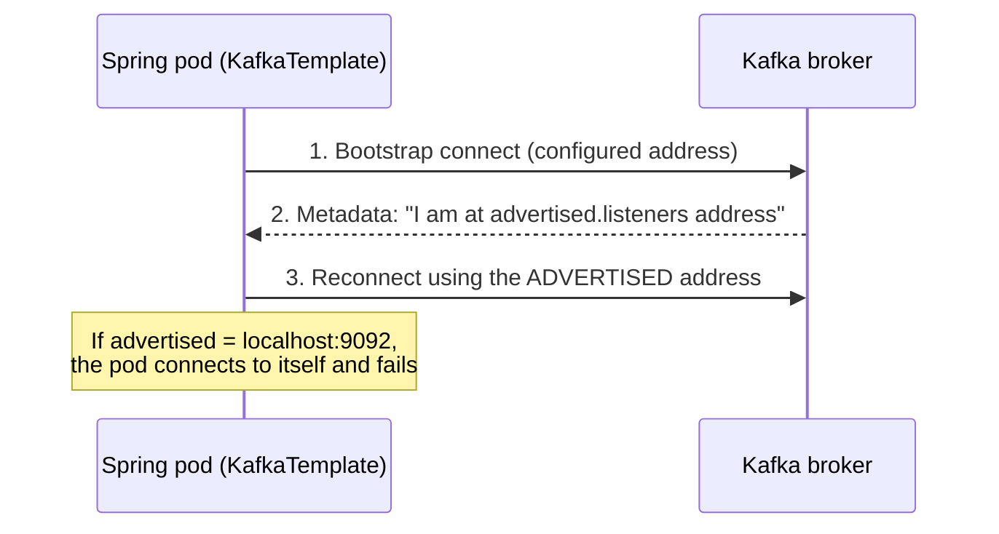
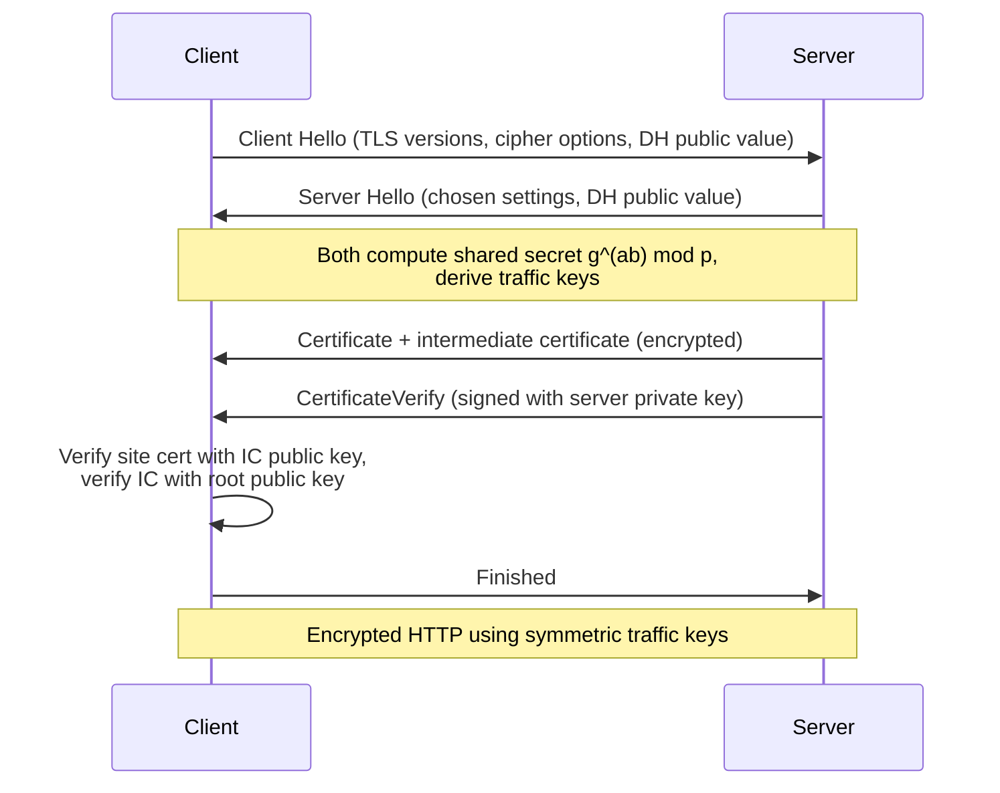
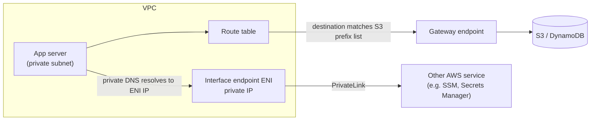
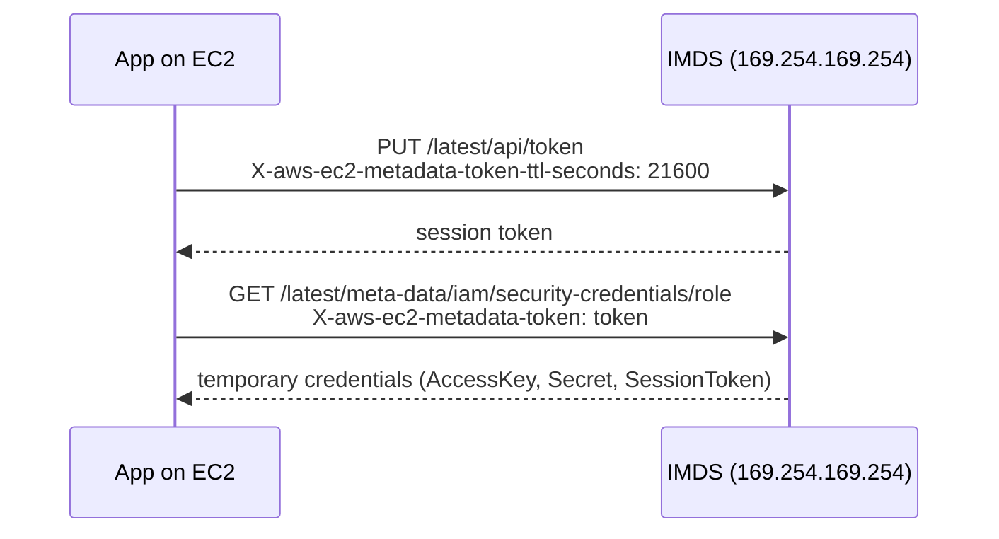
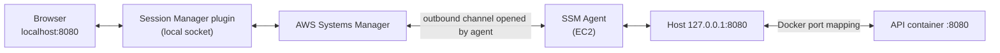
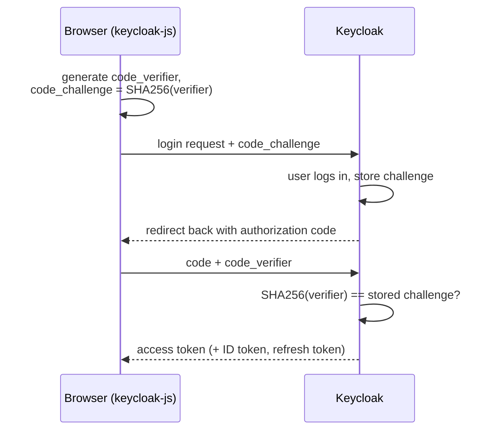

# Study Notes

## Table of Contents
1. [Payment Service](#1-payment-service)
2. [Kafka OCR Workers](#2-kafka-ocr-workers)
3. [Kubernetes / Minikube CPU Starvation](#3-kubernetes--minikube-cpu-starvation)
4. [AWS SAA / Networking Fundamentals](#4-aws-saa--networking-fundamentals)
5. [Statistics (SPC)](#5-statistics-spc)
6. [.NET: DbContext and DbContextFactory](#6-net-dbcontext-and-dbcontextfactory)
7. [Spring Annotations and Code Walkthrough](#7-spring-annotations-and-code-walkthrough)

---

## 1. Payment Service

### 1.1 Checkout retry guard: `hasCheckoutAttemptSince`

- `hasCheckoutAttemptSince(cutoff)` checks whether there is an attempt within the last *threshold* seconds (30s).
- `cutoff = now − threshold`. For example, if the current instant is `10:00:00` and the threshold is 30s, the cutoff is `09:59:30`.
- If the last checkout attempt is stamped **after** the cutoff, it is less than 30s old. This means the previous request hadn't finished, so we return **409**.
- If the last attempt is stamped **at or before** the cutoff, 30s have passed, so it should be retried and a new checkout attempt is made.
- So the cutoff marks the start of a 30s window before the current instant. If our initial checkout attempt is stamped inside that window, 30s have not passed. Realistically, if we retry after 30s, the attempt now falls before the cutoff, and only then do we retry.

> **Correction:** The original note had `isAfter()` reversed ("the current timestamp was before the cutoff, meaning it should be retried"). The comparison is `lastAttempt.isAfter(cutoff)`. **True** means the attempt is recent (409). **False** means it is stale (retry).

```
                cutoff (now − 30s)
                  ↓
---- OLD --------|---------------- NOW
                 |<----- 30s ----->|
                 |
          attempt inside this window?
                 |
            YES → 409
            NO  → retry
```



### 1.2 Checkout URL flow (Stripe → browser redirect)

1. `startCheckout` takes the session created from Stripe and calls `markCheckoutCreated`, which sets the `checkoutUrl` in `Payment`.
   - Note: `PaymentResult` is a record declared at the end of `PaymentService` with `(Payment payment, boolean replayed)`.
2. `createPayment` then wraps the result in a `PaymentResult`.
3. The controller calling `createPayment()` uses `.replayed()` to decide the HTTP response code.
4. The controller constructs the `PaymentResponse` record from `Payment`, using `from()` to copy it, including `getCheckoutUrl()`.
5. Spring's Jackson then turns that record into JSON, and each record field becomes a JSON key.
6. Finally, in `PayPanel`, `payment.checkoutUrl` reads the key for the redirect.



### 1.3 Money representation

- Amount is usually stored in the smallest unit of the currency (e.g. cents for USD, as an integer/`long`), but here it's just going to be 1.
- `BigDecimal` is used for cases where we need arithmetic calculations, because a traditional `double` is a binary floating point. Some decimal fractions can't be represented exactly in binary.

> **Correction:** `0.1` isn't stored as something like "0.1;01000101". In binary, 0.1 is an infinitely repeating fraction, so a `double` stores the nearest representable value, `0.1000000000000000055511151231257827...`. That's why `0.1 + 0.2 != 0.3` with doubles.

- We need to explicitly define the rounding policy as well (`RoundingMode`), depending on whether we want to round up or down in different cases (e.g. `HALF_UP`, `HALF_EVEN`).

> **Note:** Create `BigDecimal` from a string or `BigDecimal.valueOf(...)`, not `new BigDecimal(0.1)`. The latter copies the double's binary error exactly.

### 1.4 MongoDB transactions and the outbox

- The current MongoDB can't handle multi-document transactions. You can't chain multiple queries updating different documents in a single transaction, because a standalone Mongo doesn't offer the option to bundle several writes into one all-or-nothing unit.
- If we start Mongo in **replica-set mode** (a single-node replica set is enough for development), we get access to the transaction machinery. This lets us commit and roll back a transaction as one unit, e.g. in the case of crashes. For example, in Postgres:

```sql
BEGIN;
  UPDATE payments SET status = 'SUCCEEDED' WHERE id = 42;
  INSERT INTO outbox (...) VALUES (...);
COMMIT;   -- a crash before this line undoes both
```

- With transactions, we could separate the outbox into its own **collection**.
- It's because of this limitation that we placed the outbox inside the payment document. A write to a single document is always atomic in MongoDB, so one write gives you the all-or-nothing guarantee.
- This stops being the case when one operation triggers updates across genuinely different documents.

---

## 2. Kafka OCR Workers

### 2.1 Topology

- A single Kafka broker is shared by all pods. It is a Docker Compose container living **outside** the Kubernetes cluster, whereas the pods are inside the Minikube cluster.
- The pods communicate with the broker from within the k8s cluster through an address and port reachable from inside the cluster.
- The consumer group is defined in the worker's properties. Since all 3 pods run the same image, they are in the same group. The broker sees 3 members and splits the partitions between them.
- Each active consumer has its own thread.
- The **workers** are really just another application we isolated for processing OCR. They are the consumers in a consumer group, and **Kafka** coordinates them. The API sends the capture ID to a topic, and the key decides which of the three partitions it goes to.

### 2.2 Offsets ("bookmarks")

- The `@KafkaListener` annotation means Spring Kafka handles progress tracking in consumer groups on its own.
- Kafka stores a bookmark (the **offset**) in an internal topic called `__consumer_offsets`. It is like a pointer that moves across the partition, indicating how far a consumer group has progressed within that partition.
- Spring's listener loop behind `@KafkaListener` polls the broker, gets a batch of messages, and calls the `handleUpload()` method once per message. After the batch is processed, it tells the broker to move the bookmark past this batch (default `AckMode.BATCH`).
- When a worker dies midway through processing:
  1. The bookmark was not moved.
  2. The broker realizes that the member is gone and triggers a **rebalance**.
  3. The partition is reassigned to one of the remaining workers.
  4. That worker picks up again from where the bookmark left off.

> **Note:** This means a message can be processed **more than once** (at-least-once delivery). `handleUpload()` should be idempotent, e.g. skip if the capture is already processed.

### 2.3 How a message ends up at a worker

1. The API calls `kafkaTemplate.send("capture-uploads", captureId, captureId)`.
   - The first `captureId` is the **key**. It is hashed, so the same ID always gets sent to the same partition.
   - The second is the **value**, so the listener/consumer can use it for database lookups.
2. The producer client hashes the key and picks a partition from it (e.g. P1). The same key always lands on the same partition.
3. The broker appends the message to P1.
4. The worker consumer assigned to P1 picks it up on its next `poll()`.
5. Spring calls `handleUpload(captureId)`, and after the batch, it commits the bookmark.



### 2.4 Open concern: error handling

- With the default `DefaultErrorHandler`, a failing message is retried back to back with no delay, **10 delivery attempts in total** (1 + 9 retries). After that, it is logged and skipped.
- We need:
  - **Exponential backoff** between retries (`ExponentialBackOff`).
  - A **recovery mechanism**, so failed messages go to another topic instead of disappearing. `DeadLetterPublishingRecoverer` does this and publishes to `<topic>.DLT` by default.

### 2.5 Kafka broker address advertising

- Services in their own containers have an independent networking environment. In a plain localhost setup, the APIs can communicate through the Windows loopback interface. Containers need to rely on the Docker network, and Compose provides this via the service name.
- The Spring Boot pods connect to Kafka fine initially (the **bootstrap** connection). Upon connection, Kafka returns the broker's metadata, which advertises its address as `localhost` (relative to itself). When the producer (`KafkaTemplate` in the Spring pods) tries to connect to that address, it can't find a broker listening at localhost inside its own pod.
- Because Kafka is designed to work as a distributed cluster, each partition may be handled by a different broker, hence the need for separate, reachable addresses.



**Kafka settings:**

- `listeners=PLAINTEXT://0.0.0.0:9092`
  - `PLAINTEXT` is a non-TLS Kafka protocol. The producer sends structured binary requests to the broker without TLS encryption (`KafkaTemplate` takes care of the protocol). If encryption is needed, `SSL` (Kafka's protocol with TLS enabled) is used.
  - `0.0.0.0` means listen on all network interfaces.
- `advertised.listeners=PLAINTEXT://kafka:9092`
  - `kafka` is the hostname for a single-broker example. In a multi-broker cluster, each broker needs to advertise an address that uniquely identifies it **and** is reachable from the client's network.

> **Note:** `kafka` only resolves inside the Docker Compose network. If pods inside Minikube connect to a broker living in Compose, the advertised address must be reachable from the pods (e.g. `host.minikube.internal:<port>`). A common pattern is two listeners, e.g. `INTERNAL://kafka:9092` for Compose and `EXTERNAL://<host-reachable-address>:9094` for the cluster.

- Different brokers can share the same port number when they are distributed on different machines, because their IPs differ. If all brokers live on the same machine, the address (hostname/IP + port) must still be unique, so for local development, using different port numbers per broker is common.

---

## 3. Kubernetes / Minikube CPU Starvation

### 3.1 Container hierarchy

- **Node:** the machine that runs the pods. With the Docker driver, this is the Minikube container itself, not something within it.
- **Kubelet:** the k8s agent that runs on every node. It:
  - Starts and stops pods assigned to its node.
  - Reports the pods' status and node capacity back to the API server.
- **API server:** the k8s central point for reading and changing cluster state. Components read information from it. It checks and validates permissions and persists relevant state to **etcd** (k8s's persistent storage).
- **Scheduler:** lives within the node. Since it can't inspect the hardware itself, it simply trusts what the kubelet reports.

```
Docker Desktop Linux VM (kernel sees 16 CPUs)
└─ minikube container  ← the Node; cgroup cap 200 ms / 100 ms (= 2 CPUs)
   ├─ kubelet, kube-scheduler, API server, etcd   ← Kubernetes itself lives in here too
   ├─ API pods ×3      (request 250m each = 750m)
   ├─ Worker pods ×3   (request 500m each = 1500m)
   └─ Prometheus, Grafana, exporters, ...
                        total requests ≈ 2700m (2.7 CPUs)
```

**What happens when you run `kubectl get nodes`:**

1. `kubectl` sends an HTTP request to the Kubernetes API server.
2. The API server handles the request and returns the node information.
3. `kubectl` displays the result in your terminal.

So `kubectl` is the client, and the API server is the server that handles the request.

### 3.2 Why the node reports 16 CPUs

- The kubelet finds the node's capacity by asking the kernel. The Minikube container shares the Docker VM's Linux kernel, which in this case has **16 CPUs**.
- The cap on the Minikube container is declared elsewhere, in a **cgroup** file. A cgroup cap is a rule on how much CPU **time** is allowed, not how many CPUs exist.
- The kubelet doesn't read that cap, by design, so it reports the VM's hardware (16 CPUs).

### 3.3 Requests ("bookings") vs limits

- A **booking** is the pod's resource **request** defined in `deployment.yaml`, e.g. `cpu: "250m"` is a quarter of a full CPU. `worker.yaml` books `500m` per worker.
- 3 APIs (750m) + 3 workers (1500m) + Prometheus, Grafana, exporters, etc. comes to around 2700m, i.e. **2.7 CPUs**.
- When the scheduler compares the bookings, it sees that the node's reported capacity (16) can fit them. This is a **requests** check, not a limits check. So it simply places all the pods.
- However, it is the Docker VM's Linux kernel that enforces the cgroup cap, so in reality there is only 2 CPUs' worth of CPU time for all the pods. This causes **starvation**.

### 3.4 CFS period and quota

The kernel cap has two variables:

- **Period:** how often the budget (quota) refills. The default Linux period is **100ms**.
- **Quota:** the total CPU execution time allowed per period, **summed across all CPUs**.
  - Two cores can each contribute 100ms of work in parallel, giving a total of 200ms while only 100ms of real time passes.
  - Quota therefore scales with the number of CPUs: busy cores consume CPU time n times as fast as one core.
  - Example: one core needs 200ms of real time to use up a 200ms quota, but two cores need only **100ms**.

**Period trade-off:**

- **Shorter periods:** more frequent replenishment and smoother CPU availability, but more quota accounting and bookkeeping.
- **Longer periods:** longer throttling pauses once the quota is exhausted.

**Formula:**

```
quota = CPU limit × period
```

- The limit defines utilization **in units of one CPU core**. A limit of 0.5 means a full core working for half the time, **not a smaller core**. It will only execute for half of the real time elapsed, e.g. a 0.5 limit over a 100ms period gives 50ms of execution.
- The period plays two roles:
  1. It is a recurring schedule, independent of the CPU execution time.
  2. It acts as a **real-time accounting window**, tracking how much real time has elapsed. It is used in the formula to answer: "if the CPU runs this fraction of the time (relative to real time), how much CPU execution time is that?"
- A longer period favours tasks that need to run in larger chunks in one go. With a 0.5 limit:
  - **1s period → 500ms quota:** an 80ms task finishes before the quota needs replenishing.
  - **100ms period → 50ms quota:** the same 80ms task is throttled after 50ms and must wait for the next refill to finish.

### 3.5 Pending vs starvation

| | Pending | Starvation |
|---|---|---|
| **What** | A new pod's **request** is greater than what remains on the node (capacity minus existing bookings) | Real CPU **demand** is bigger than the CPU time actually available |
| **Symptom** | The pod is queued and not scheduled; it retries until a pod is deleted or another node is added | Every pod is `Running`, but very slow |
| **Checked by** | Scheduler (requests vs reported capacity) | Kernel (cgroup quota) |

### 3.6 The original dilemma

- Minikube's `--cpus 2` causes starvation not by restricting the pods to 2 cores, but to **2 CPUs' worth of execution time**. The kernel can choose to run threads on any of the 16 cores.
- There are 8 JVMs, each running multiple threads at startup. In the worst case, all 16 cores run threads at once and share the 200ms quota, so each core only gets 12.5ms (200 / 16) of execution before the whole container is paused for the remaining 87.5ms of the period.
- **Regardless**, the throttling pattern itself wasn't the cause of the slowness. The demand was simply too high for a 200ms-per-100ms supply.
- This is why the fault lies in **starvation, not pending**. We initially suspected the 2.7 CPU bookings wouldn't fit 2 CPUs, but that isn't what happened: 16 CPUs were reported to the scheduler, so every pod was scheduled and running, just very slowly.

---

## 4. AWS SAA / Networking Fundamentals

### 4.1 CIDR and AWS Organizations

- **CIDR** defines the IP address range available for the VPC and its subnets.
- A company can have multiple AWS accounts for managing the different services it offers, e.g. one for food, one for payments. Each has its own root user and resources.
- The **management account** is one of the AWS accounts. It is assigned a special organizational role: it enforces **SCPs** (Service Control Policies) and handles **consolidated billing**.
- The other accounts are **member accounts** under the **AWS Organization**.

> **Note:** SCPs restrict member accounts. They do not restrict the management account itself.

### 4.2 Web server (public subnet)

A web server in the public subnet acts as a **receptionist** for incoming requests:

- **Serves static files** (HTML, CSS) without involving the application server.
- **Forwards requests** that require business logic to the application server in the private subnet, using routing rules that match the URL against where it should go.
- **Can terminate TLS**, depending on which layer HTTPS terminates at:
  - At **Nginx** (the web server): Nginx handles the TLS handshake.
  - At an AWS **Application Load Balancer**: the ALB handles it, and forwards the decrypted request to the web server.

> **Correction:** The ALB normally sits **in front of** the web server (client → ALB → Nginx → app), so when TLS terminates at the ALB, the ALB forwards to the web server, not the other way around.

### 4.3 TLS handshake (after TCP is established)

1. **Client Hello:** the browser/client presents its TLS version and cryptographic options to the server.
2. **Server Hello + certificate:** the server (the TLS endpoint) selects cryptographic settings it supports and presents its **certificate**, an identity card ensuring the server serving the website is legitimate. A certificate contains:
   - The subject (domain name the certificate is for).
   - The site's **public key**.
   - A validity period.
   - The issuer.
   - A signature (the issuer's signature over the certificate's contents).

   **Chain validation:**
   1. The server sends the website's certificate along with an **intermediate certificate (IC)**. The IC belongs to the issuer of the website's certificate, which the root CA (anchor) has delegated the right to issue certificates.
   2. The browser uses the IC's public key to verify the signature on the site's certificate. If valid, it proves the certificate's contents haven't been altered and were signed by whoever holds the IC's private key. This doesn't yet prove that the IC itself is trustworthy.
   3. The browser then uses the **root certificate's** public key (already in the browser/OS trust store) to verify the signature on the IC. If that is valid, the IC can be trusted.

   > **Note:** The server also proves it owns the certificate by signing the handshake with its **private key** (the `CertificateVerify` message). Without this, anyone could replay a public certificate.

3. **Key establishment:** the client and server establish encryption keys, after which they exchange encrypted HTTP data.
   1. Key derivation starts with **Diffie-Hellman key exchange**. Both sides agree on two public numbers: `p`, a large prime, and `g`, a base for exponentiation.
      ```
      public value = g^x mod p
      ```
      Each side generates its own private value independently, calculates its public value with `x` set to that private value, and sends it across the network.
   2. Each side computes the **shared secret** by raising the other's public value to its own private value. Both get the same result:
      ```
      A = g^a mod p          B = g^b mod p
      S = B^a mod p = (g^b mod p)^a mod p = g^(ab) mod p
      S = A^b mod p = (g^a mod p)^b mod p = g^(ab) mod p
      ```
      This works because taking the remainder first and then raising to a power gives the same remainder as raising first and then taking the remainder.
   3. TLS 1.3 then uses **symmetric cryptography**. The shared secret is fed into a key-derivation function, from which both sides independently produce the same **client** and **server traffic keys**. The client encrypts with the client key and the server decrypts with that same key, and vice versa for the server key.

> **Note:** The order above matches TLS 1.2 conceptually. In **TLS 1.3**, the client sends its DH public value already in the Client Hello, so keys are derived immediately and the certificate is sent **encrypted**. TLS 1.3 also typically uses elliptic-curve DH (ECDHE) rather than plain `g^x mod p`, but the idea is the same.



### 4.4 Private subnets, Security Groups and NACLs

- We segregate the application and database servers inside the private subnet so no outsiders can contact them directly, minimizing the attack surface.
- **Security groups** and **NACLs** (Network Access Control Lists) are the layers of security beneath that:
  - **Security group:** attached to the instance's ENI; **stateful** (return traffic is allowed automatically).
  - **NACL:** applied at the subnet level; **stateless** (inbound and outbound rules are evaluated separately).

### 4.5 VPC endpoints

**Gateway endpoint** (S3 and DynamoDB only)

- Adds one entry to the route table that directs the service's traffic through the endpoint.
- The destination is a **prefix list**, e.g. the S3 prefix list represents a collection of IP address ranges. If **outgoing** traffic's destination IP matches that range, the route table sends the packets to the endpoint (an identifier the VPC knows how to handle), instead of going through a NAT gateway and IGW.

**Interface endpoint** (AWS PrivateLink)

- Creates an **ENI** (Elastic Network Interface) with a private IP address in a subnet.
- The application uses the service's private DNS name, which resolves to that private IP. The request travels through AWS's private network to the supported service, without needing a NAT or IGW.
- An **ENI** is a virtual network card attached to a resource in the VPC. For example, the application server in the private subnet has an ENI with a private IP, security groups, a MAC address (the identifier of the network interface), etc.
- The interface endpoint sits in the private subnet alongside the application server and connects to the requested service via AWS's internally managed network infrastructure.



### 4.6 IGW vs NAT gateway

Both translate between private and public addresses, but differently:

- **Internet Gateway (IGW):** translates between a resource's own **public IPv4 address** (assigned to the resource and managed by AWS) and its private IP, both ways. The public IP is never configured on the machine; its OS only knows its private IP.
- **NAT gateway:** translates a resource's private IP into the **NAT gateway's own** public IP, for **outbound-only** internet access. The NAT gateway itself sits in a public subnet and sends traffic out through the IGW.

### 4.7 SSH public-key authentication

1. The client connects to the destination server's public IP. First, the **server** proves its identity with its host key, and both sides establish an encrypted session.
2. The client claims it owns the private key matching a public key the server has stored (in `~/.ssh/authorized_keys`).
3. The client signs data unique to this session using the private key, creating a digital signature, and sends it to the server.
4. The server uses the stored public key to verify that the signature was made by the matching private key. If it matches, the server trusts your identity and opens the shell.

> **Correction:** In SSH-2, the server doesn't send a random piece of text to sign. The client signs the **session identifier** (derived from the key exchange), which serves the same purpose: it's unique per connection, so a signature can't be replayed.

### 4.8 Spread vs Partition placement groups

- **Spread:** places each instance on **different physical racks/hardware**, so if one fails, the others don't. Limited to 7 running instances per AZ per group.
- **Partition:** groups instances into partitions, and each partition has its **own set of racks**.
  - E.g. if each of 2 partitions has 3 servers, servers in the same partition may share a rack, but a server from one partition can't share a rack with a server from another.
  - The purpose is to prevent a rack failure from affecting servers in different partitions, which is the same idea as Spread. The difference is that **Partition is designed for workloads that need many instances organized into groups** (e.g. Kafka, HDFS, Cassandra).

### 4.9 SAN vs NAS

**Storage Area Network (SAN): block storage**

- A dedicated network giving servers access to shared storage. A database server, for example, connects to the shared storage system and uses it as if it were a locally attached disk.
- This is achieved through a storage networking standard such as **iSCSI**, which relays storage commands across an IP network to a remote **storage array** (a dedicated storage system with multiple SSDs/HDDs and network interfaces). The array's controller finds the requested data and returns it.
- The database receives the response as though it read the data from a local disk drive.

**Network Attached Storage (NAS): file storage**

- Also dedicated storage, but it provides **files** instead of raw storage blocks, arranged in a hierarchical folder structure like on a regular PC.
- **Access flow:**
  1. We access the shared folder using a path on our local device (a network path such as `\\fileserver\Engineer`). Windows resolves the server name to a network address.
  2. It connects to the file server using **SMB** (Server Message Block), the protocol commonly used for network file sharing on Windows.
  3. The NAS checks permissions. Opening `\\fileserver\Engineer` in File Explorer only requests the **directory listing** for it, not the files' contents.
  4. Only when you actually open a file does Windows ask the NAS to send that file's data across the network.
- Once the file bytes arrive on your PC, they're held in memory and maybe cached locally, or you can download a local copy.
- If the network drops while the file is open, content already loaded can still be displayed, but navigating to a part that needs uncached data may fail. E.g. for a 10-page PDF, the first request may have only fetched part of the file, so later pages may not have loaded yet.

### 4.10 IMDSv2 (Instance Metadata Service v2)

- **IMDS** is an API (at `169.254.169.254`) that an EC2 instance calls to ask about its own environment.
- To obtain temporary role credentials for AWS services:
  1. The server sends an HTTP **PUT** to `/latest/api/token`, requesting a **session token** and specifying its TTL in a header (`X-aws-ec2-metadata-token-ttl-seconds`).
  2. The server attaches that token in a header (`X-aws-ec2-metadata-token`) for all subsequent **GET** metadata requests.
  3. IMDS returns the temporary role credentials on `GET /latest/meta-data/iam/security-credentials/<role-name>` + session token. STS is not contacted directly by the instance; AWS handles the issuance behind the scenes.
- **Why PUT instead of GET (SSRF defence):**
  - SSRF (Server-Side Request Forgery) vulnerabilities usually only let an attacker trigger simple **GET** requests and rarely allow custom header injection. Requiring a PUT plus a custom header blocks basic SSRF attempts.
  - IMDSv2 also **rejects token requests containing `X-Forwarded-For`**, so requests relayed through a misconfigured reverse proxy fail.
  - The token response has an IP **hop limit** of 1 by default, so it can't travel beyond the instance (e.g. to another host).

> **Correction:** The original said reverse proxies and firewalls are configured to block inbound PUT. The protection actually comes from SSRF bugs typically being unable to send PUT/custom headers, plus IMDSv2 itself refusing proxied requests and limiting hops.



### 4.11 AWS Systems Manager (SSM), SSM Agent, Session Manager plugin

- The **SSM Agent** on the Linux server first establishes an **outbound** connection to AWS Systems Manager. The manager can then send instructions back through that connection; data flows both ways over this channel, so no dedicated inbound connection (or open port 22) is needed.
- **Port forwarding flow:**
  1. When we start a port-forwarding session via the CLI, the **Session Manager plugin** opens a listening socket locally and relays traffic to Systems Manager.
  2. Systems Manager forwards it through the agent's established channel.
  3. The SSM Agent connects to the target port on the instance's own `localhost` (e.g. `127.0.0.1:8080`).
  4. Since we already defined the Docker port mapping, traffic arriving at host `127.0.0.1:8080` is forwarded to port 8080 inside the API container.
- **The response travels back the same way:**
  1. The API generates a response.
  2. Docker sends it through the port mapping to the connection opened by the SSM Agent.
  3. The agent relays it back to Systems Manager.
  4. AWS transports it through the session established with the local plugin.
  5. The plugin writes the response back into the browser's local TCP connection.



---

## 5. Statistics (SPC)

### 5.1 Sample variance: why divide by n − 1 (Bessel's correction)

- If we calculate variance from a sample of n readings and divide by n, it tends to **underestimate** the spread of the whole population.
- The reason: deviations above and below the **sample mean** add up to 0, because the mean was calculated from those same n readings. The sample mean sits closer to its own data than the true population mean does, so the squared deviations come out smaller.
- Dividing by n − 1 means losing one **degree of freedom** (how many values can vary independently once a constraint is imposed). E.g. for 3 numbers with a known mean, the 3rd number is fixed by the 1st and 2nd.
- On average, the sum of squared deviations from the sample mean is short by **exactly one population variance**: it equals (n − 1)σ² instead of nσ².
- **Example:** true population variance σ² = 10, n = 5.
  - Squared deviations about the **true** mean would sum to about 50 on average.
  - Squared deviations about the **sample** mean only sum to about **40** (= 4 × 10).
  - Dividing 40 by 5 gives 8 (biased low). Dividing by n − 1 = 4 gives **10** (correct).

> **Correction:** The original said estimating from a sample "underestimates the population **mean**"; it's the population **variance** that gets underestimated. The section title also should be *sample* variance, not *population* variance.

### 5.2 X̄ (mean) and R (range) charts

- **X̄ chart:** tracks changes in the process's **centre**. E.g. when a nozzle becomes worn, it might consistently deposit slightly more material, producing a subgroup mean larger than for a normal nozzle.
- **R chart:** tracks changes in the subgroup's **spread**, i.e. how widely the units produced within each subgroup vary around their mean.

---

## 6. .NET: DbContext and DbContextFactory

- **DbContext** is a base class offered by **Entity Framework Core** (an ORM for .NET, the bridge between C# code and a relational database). It represents an active session with the database and:
  - Manages transactions.
  - Translates LINQ queries into database operations, so we don't write SQL by hand.
  - Retrieves results and turns them back into C# objects (and tracks changes to them).
- **DbContextFactory** is the context creator. Whenever a service needs to work with the database, it creates a fresh `DbContext` for that operation.
- **Why:** a shared `DbContext` is **not thread-safe**. If two separate operations (one adding results, one querying) use the same context at the same time, they both touch the context's internal change-tracking state and interfere with each other. EF Core throws an `InvalidOperationException` when it detects this.
- This doesn't affect **database-level** concurrency. The database has its own mechanisms for handling simultaneous reads and writes.

---

## 7. Spring Annotations and Code Walkthrough

### 7.1 Startup

**ORM / ODM**

- **Hibernate** is the ORM used for SQL with Spring (it implements JPA).
- **Spring Data MongoDB** maps classes to documents, so it is an **ODM** (Object-Document Mapper).

**`@Component` vs `@Bean`**

- `@Component` declares a **bean** on classes **we** write. Spring calls their constructor itself and injects the parameters.
- `@Bean` is used inside a `@Configuration` class for classes that come from libraries/SDKs, or ones that need builder calls to set up (`.build()`).

**Component scanning**

1. During startup, Spring scans the package of the main class (`@SpringBootApplication`) and every sub-package under it. A package is the namespace that organizes classes (the folder), e.g. `com.capturetotext.app.ratelimit`, where `com.capturetotext.app` is the main package.
2. It looks for annotated classes in each file, and each `@Component` is constructed **once as a singleton** (the default scope).
3. The beans listed in a class's constructor parameters are built first and handed in (**constructor injection**).

**Constructors and fields**

- A constructor has the same name as the class and no return type. It runs when an instance is created, usually followed by `this.x = x`, so the instance keeps the constructor parameters and can use them in its methods later.
- Fields with initializers (declared before the constructor) are initialized when the object (here, the bean) is constructed.

> **Correction:** Instance fields belong to **each object**, not the class; only `static` fields belong to the class. Because a Spring bean is a singleton, there's only one instance, so its fields are effectively shared by everyone using that bean.

**`WebMvcConfigurer`**

- An interface whose methods are optional hooks for customizing **Spring MVC** (the part of Spring that routes HTTP requests to controller methods).
- `addInterceptors(InterceptorRegistry registry)` is a callback that Spring MVC's setup code calls **once at startup**:
  1. When creating the request-routing object (the `HandlerMapping`), it creates a registry and hands it to each configurer.
  2. Our configurer registers the interceptor into the registry.
  3. Spring copies everything registered onto the router, so the interceptor joins the request pipeline.

**`@ConfigurationProperties`**

- A way of reading a whole block of keys from `application.properties` into a typed object.
- For `RateLimitProperties`, it takes every property matching the prefix and binds each key to the record's declared fields.
- The matching is **relaxed**: it ignores case, dashes and underscores, so `max-requests`, `maxRequests`, `max_requests` and `MAX_REQUESTS` all bind to `maxRequests`.
- In our case, two records/sections are bound, one for `payment.*` and one for `api.*`. The bean is injected into the interceptor, which picks the matching limit at runtime based on the request (e.g. its path). *(Verify this against the interceptor code.)*

> **Note:** The properties class must be registered, via `@EnableConfigurationProperties(RateLimitProperties.class)` or `@ConfigurationPropertiesScan`.

### 7.2 Login (Keycloak, OAuth 2.0, OIDC, PKCE)

**Keycloak basics**

- A Keycloak **realm** is an isolated logical container. Users in a realm can only access the applications defined within it; they can't log in to applications in another realm, nor see the users in that realm.
- The test username and password come from the `realm.json` we wrote. Keycloak reads it, hashes the passwords and stores them inside the container where it lives.
- **OAuth 2.0** handles **authorization** (what the client may access).
- **OIDC** (OpenID Connect) is the layer on top that handles **authentication**: it hands out an **ID token** proving who the user is.

**PKCE (Proof Key for Code Exchange)**

PKCE prevents a stolen authorization code from being exchanged for tokens.

1. At every login attempt, the browser creates a one-time random secret (the `code_verifier`) and hashes it with SHA-256 (the `code_challenge`). It sends the **hash** with the login request to Keycloak.
2. The user logs in. Keycloak remembers the challenge and sends back a temporary **authorization code**.
3. The browser sends the code back together with the **original, unhashed** verifier.
4. Keycloak hashes the verifier and checks it matches the challenge it received earlier.
5. If it does, the client requesting the token is proven to be the same one that started the login, and Keycloak sends the **access token**.



These steps are packaged inside `keycloak-js`:

- `login()` builds the challenge and redirects to Keycloak.
- When the browser returns, `init()` detects the code in the URL, completes the exchange and stores the tokens.

**Access token (JWT)**

The access token is a **JWT**: a JSON object signed by Keycloak, which the browser attaches to every subsequent server request. Roughly:

```json
{
  "sub": "permanent UUID issued for the user",
  "iss": "the issuer, who signed it (Keycloak realm URL)",
  "aud": "the audience, who this token is meant for (the API)",
  "exp": "the expiry, by default 5 minutes after issue"
}
```

> **Correction:** `keycloak-js` keeps tokens **in memory** by default, not in `localStorage`.

**Server-side validation (`spring-boot-starter-oauth2-resource-server`)**

1. Every API request includes the token in the `Authorization: Bearer <token>` header.
2. Spring downloads Keycloak's list of public keys (the **JWKS** endpoint) and caches them.
3. For every request, Spring checks the token locally:
   1. It picks the matching public key using the token's `kid` header.
   2. It hashes the token's header and payload.
   3. It uses the public key to verify that the signature matches that hash.
   4. It checks `exp`, `iss` (and `aud`, if configured).
4. If valid, Spring stores the authenticated JWT in the **SecurityContext** for this request.
5. `@AuthenticationPrincipal Jwt jwt` in a controller injects that already-verified token, so the controller can read claims such as `jwt.getSubject()` (the user's `sub`) to know **which user** made the request.

> **Correction:** With RSA signatures, verification isn't "decrypting" the signature. It's a verify operation using the public key that confirms the signature was produced over that exact hash by the matching private key.